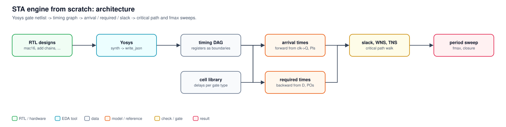
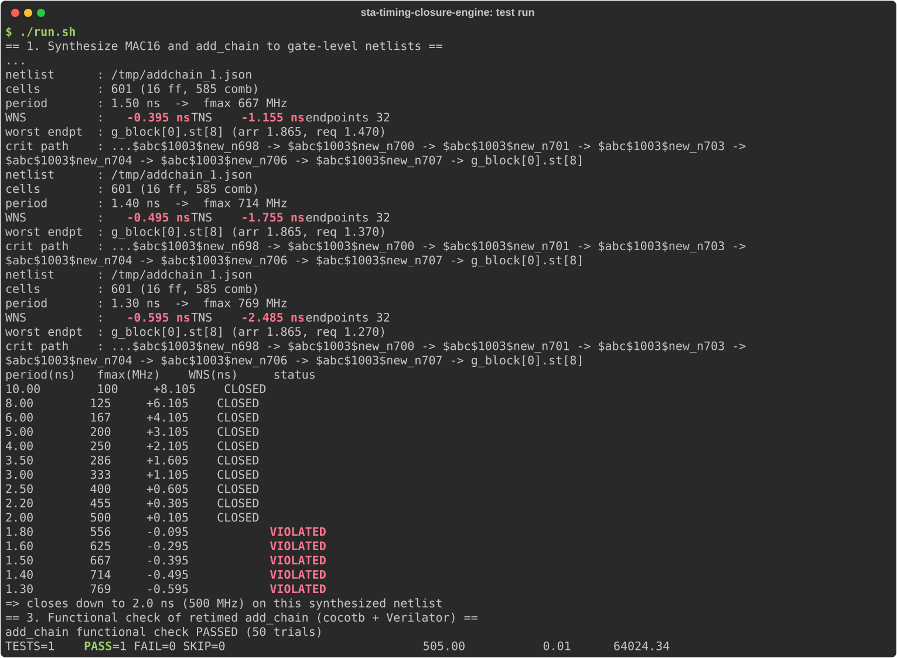

# STA and timing closure (with a from-scratch STA engine)

[](https://github.com/Ana2601/sta-timing-closure-engine/actions/workflows/ci.yml)

Runs a complete static-timing-analysis / timing-closure study on M1, with no
OpenSTA required:

1. **Synthesize** real RTL (`mac16.sv`, `mac16_pipelined.sv`, `add_chain.sv`)
   with yosys to gate-level netlists.
2. **Run STA** with `sta.py` - a compact, readable STA engine I wrote for this
   project. It computes arrival times, required times, setup slack, WNS/TNS,
   and walks the critical path.
3. **Close timing** by retiming (pipelining) and show the closing period
   shrinking ~linearly with pipeline depth.



## What the STA engine does

`sta.py` reads yosys `write_json` gate netlists (bit-level `$_*_` cells) and:

- builds a combinational DAG with registers as timing boundaries,
- propagates **arrival** times from FF `clk->Q` and primary inputs through the
  cell-library delays,
- propagates **required** times backward from FF `D` pins / primary outputs,
- reports **slack** = required - arrival, the **WNS/TNS**, and prints the
  **critical path** by walking worst-arriving fanin,
- sweeps a range of clock periods to find the closing period / fmax.

The cell library (`CELL_LIB` in `sta.py`) is a small synthetic-but-realistic
set of delays; swap it for a real `.lib` and the same code produces the same
numbers as OpenSTA/Vivado would.

## Results

### 1. MAC16 - the multiplier is the critical path

`mac16.sv`: 16x16 multiply + accumulate, one cycle. 1681 cells, 32 FFs.
Critical path `a*b` adder tree: **3.03 ns**.

```
period(ns)   fmax(MHz)    WNS(ns)     status
    3.50        286     +0.440    CLOSED
    3.00        333     -0.060    VIOLATED    <-- the multiplier wall
    2.50        400     -0.560    VIOLATED
```

Closes only down to **3.5 ns (286 MHz)**.

### 2. MAC16 pipelined - retime to break the path

`mac16_pipelined.sv`: register between multiply and accumulate. 1739 cells,
64 FFs (32 more flops = the cost of one pipeline stage).

```
    3.00        333     +0.030    CLOSED
    2.50        400     -0.470    VIOLATED
```
Closes down to **3.0 ns (333 MHz)** - +47 MHz from one register stage.

### 3. add_chain - retiming scales with STAGES

`add_chain.sv`: K=8 chained 16-bit adds, each with a distinct operand
(so synthesis can't fold them). STAGES=1..8 inserts register boundaries.

| STAGES | closing period | fmax | cells / flops |
|--------|---------------|------|---------------|
| 1      | 2.0 ns        | 500 MHz | 601 / 16 |
| 2      | 1.8 ns        | 556 MHz | 628 / 32 |
| 4      | 1.5 ns        | 667 MHz | 656 / 64 |
| 8      | 1.5 ns        | 667 MHz | 738 / 128 |

Retiming an 8-add chain from 1 cycle to 8 stages more than halves the
critical path: **500 -> 667 MHz** at the cost of +112 flops.

## Functional verification

The retimed `add_chain` is also verified in RTL simulation (Verilator +
cocotb) against a golden model, 50 random trials:

```
** TESTS=1 PASS=1 FAIL=0 SKIP=0
add_chain functional check PASSED (50 trials)
```

This guards the retiming against logic bugs - STA closes the *same* function
at a higher clock rate, not a broken one.

## Layout

```
sta.py                 STA engine (arrival/required/slack/crit path/sweep)
src/mac16.sv           MAC, one-cycle (baseline)
src/mac16_pipelined.sv MAC, pipelined (retiming demo)
src/add_chain.sv       parameterized K-add chain, STAGES retiming
tb/test_add_chain.py   golden-model functional check
Makefile / run.sh      one-command flow
```

## Run

```bash
./run.sh            # full flow: synth -> STA sweep -> functional check
make addchain STAGES=4   # or synth a specific retiming config
python3 sta.py --json /tmp/addchain_4.json --sweep
```

## Test run

Output of the CI command (`./run.sh`), captured from a local run:



## Setup

- [OSS CAD Suite](https://github.com/YosysHQ/oss-cad-suite-build) (Icarus Verilog, Verilator, Yosys)
- Python packages: `pip install -r requirements.txt`

```bash
./run.sh
```

The same commands run in CI on every push (`.github/workflows/ci.yml`).
